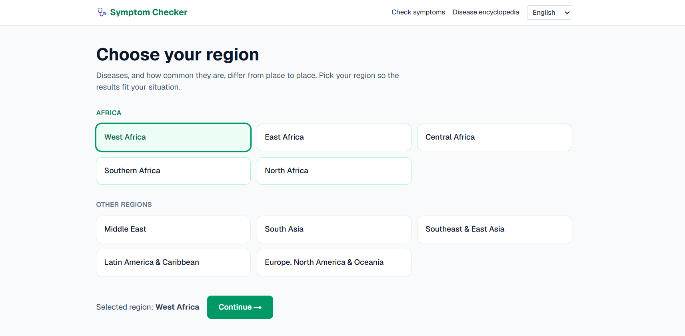
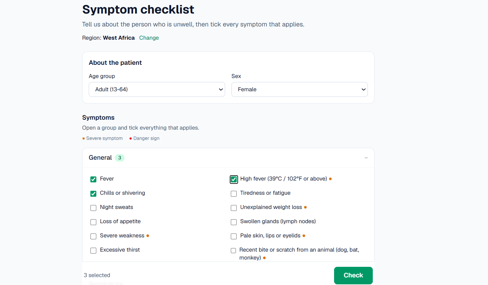
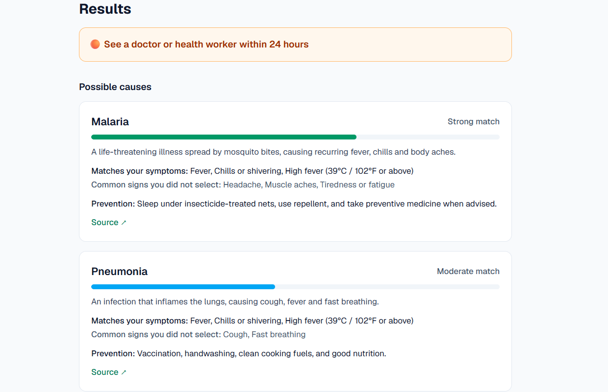
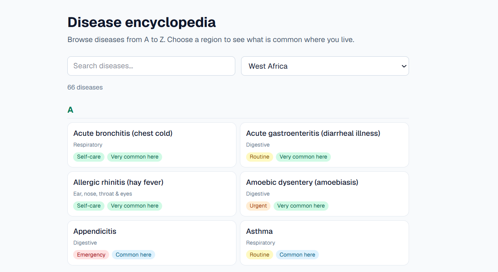
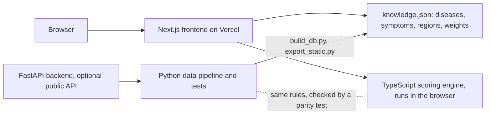

# 🩺 Symptom Checker & Disease Encyclopedia

An educational web app that helps people understand common illnesses and decide how urgently to seek care. It is **built first for Africa and other developing regions**, where reliable health information is hardest to find, and it is available in **English and French**.

> ⚠️ **Not medical advice.** This project is for education and portfolio purposes. It does not diagnose, and it must not replace a doctor or health worker.

**Live demo:** https://symptom-checker-livid.vercel.app (hosted on free plans, so the first load after a quiet period can take up to a minute while the server wakes up)



## Features

- **Region-aware results.** Pick your region first. The same symptoms rank differently in West Africa than in Europe, because disease prevalence differs.
- **Checkbox symptom checker.** 102 symptoms grouped by body system and tagged minor, severe or danger sign. A free-text box lets people describe a symptom in their own words (English or French) and tap the matching checklist item, with no AI and no cost.
- **Safety first.** Any danger-sign symptom (chest pain, stiff neck, seizures, shortness of breath, etc.) immediately stops the analysis and shows an emergency alert. No diagnosis is attempted.
- **Urgency levels.** Every result shows 🔴 emergency, 🟠 see a doctor within 24 hours, 🟡 routine, or 🟢 self-care.
- **Explainable matches.** Each result shows which of your symptoms matched, which common signs you did not select, prevention advice and a link to an official source. Match strength is shown as strong, moderate or possible, not as a fake probability.
- **Disease encyclopedia.** 100 diseases, searchable A-Z, filterable by region, with cause, prevention, typical signs and where the disease occurs.
- **Bilingual.** A language dropdown switches the whole interface and all medical content between English and French.
- **Fast and offline-friendly.** The scoring engine runs inside the browser from one small data file, so there is no server to wake up and pages load instantly, even on a slow connection.
- **Pregnancy aware.** Adult women can say they are pregnant, which adds pregnancy warning signs (bleeding, severe headache with blurred vision, swelling of the face or hands, reduced baby movement, leaking fluid, labour pains) that trigger the emergency alert, and raises the urgency of fever and urine symptoms.

| Symptom checklist | Results |
|---|---|
|  |  |



## Architecture



The website needs no server at run time. A Python pipeline builds the SQLite database and exports it to one JSON file, and the scoring engine is written twice (Python and TypeScript) with identical rules. The two were compared on 3,000 random inputs and gave identical results. The FastAPI backend remains as a documented public API.

**Stack:** Next.js (React, TypeScript, Tailwind CSS), FastAPI (Python), SQLite, pytest.

## How the scoring engine works

1. **Red flags first.** If any selected symptom is a danger sign, the engine stops and returns an emergency alert.
2. **Symptom match.** For every disease it combines how much of the selected symptoms the disease explains with how much of the disease's typical picture is present, using per-symptom weights from 0 to 1.
3. **Evidence guard.** A single symptom is weak evidence, so one lone symptom always yields a "possible" match at most.
4. **Region.** Scores are multiplied by how common the disease is in the selected region (very common, common, rare, or absent).
5. **Age, sex and commonness.** Small adjustments for diseases that affect children, older adults or one sex more, and for diseases that are much more or less common than their symptom profile suggests.
6. **Urgency.** The overall level follows the most urgent likely match. Any severe symptom raises it to at least "see a doctor within 24 hours".

The engine is deterministic and auditable. There is no black-box model.

## Data

- 100 diseases, 102 symptoms, 10 regions (five African regions, plus Middle East, South Asia, Southeast & East Asia, Latin America, and Europe/North America/Oceania), all with English and French text.
- Disease coverage is weighted towards illnesses with a high burden in Africa and other developing regions, plus common conditions found everywhere.
- Every disease links to a public-health source (WHO, CDC or MedlinePlus). The app never gives drug names or doses.
- Symptom weights, prevalence levels and commonness values are **my own estimates, informed by public sources**. They are not clinically validated.

## Validation

`python backend/validate.py` runs the engine against 75 clinical test cases (67 disease cases and 8 danger-sign cases, including pregnancy).

| Metric | Result |
|---|---|
| Danger-sign cases caught as emergency | 8 / 8 |
| Correct disease ranked first | 66 / 67 (99%) |
| Correct disease in top 3 | 67 / 67 (100%) |
| First run on the original 70-disease version | 33 / 35 ranked first (94%), 35 / 35 in the top 3 |

**Honest caveat:** the test cases were written by the same person who set the weights. Several commonness values (for UTI, STI, COVID-19 and plague) were adjusted after cases failed, so those cases are no longer independent tests. These figures show internal consistency, not real-world accuracy. The one case not ranked first is bubonic plague, which ranks second: the engine favours common diseases even when a rare one has a very specific symptom. Independent clinician review is the most important next step.

The pytest suite (104 tests) also checks data integrity, region effects, the red-flag rule, the pregnancy rules, French output, and that the website data file is up to date.

## Run it locally

```bash
# 1. Backend
pip install -r backend/requirements.txt
python backend/build_db.py          # builds data/health.db
python backend/export_static.py    # exports the data the website uses
cd backend
python -m uvicorn main:app --reload # http://127.0.0.1:8000/docs

# 2. Frontend (new terminal)
cd frontend
npm install
npm run dev                         # http://localhost:3000

# 3. Tests and accuracy report
pip install pytest
python -m pytest backend/tests -q
python backend/validate.py
```

## Project structure

```
data/        schema, seed JSON (diseases, symptoms, regions), modifiers, test vignettes
backend/     FastAPI app, scoring engine, database builder, tests, link checker
frontend/    Next.js app (region picker, checklist, results, encyclopedia)
docs/        screenshots
```

## Limitations and ethics

- **Not a diagnostic tool.** Many illnesses look alike, and some serious ones can have mild or no symptoms.
- **Small scope.** 100 diseases cannot cover everything. A person can have something this app does not know about.
- **No travel history yet.** Someone who has just returned from another region is scored by the region they select.
- **Medical content is unreviewed.** Descriptions and weights were drafted with AI assistance and public sources and have not been reviewed by a clinician. French text has not been reviewed by a native medical translator.
- **Privacy.** The app stores nothing on a server. Language and region are saved only in your own browser.
- **Pregnancy is only partly covered.** Warning signs trigger an emergency alert, but there is no after-birth (postpartum) mode, and the engine does not weigh gestational age.

## Roadmap

- Clinician review of data and an independent test set
- Optional recent-travel input
- More languages (Swahili, Arabic, Portuguese, Hausa)
- Installable offline app (PWA) for low-connectivity areas
- Admin panel for editing diseases and sources

## Author

Built by Alusine Bah.